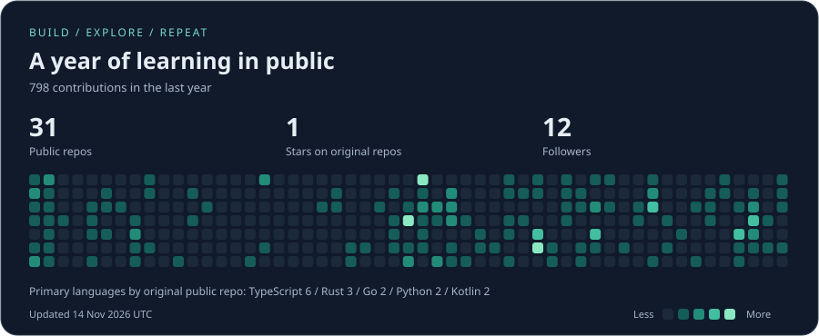

  <h1>Alexander C.S.L.</h1>
  
<strong>Full-stack development · AI applications · Blockchain</strong>

  
I like turning ideas into software I can use, inspect, and keep improving.

  

    <a href="https://github.com/alexcsl?tab=repositories">Explore my code</a> &nbsp; / &nbsp;
    <a href="https://www.linkedin.com/in/alexcsl/">LinkedIn</a> &nbsp; / &nbsp;
    <a href="mailto:alexandercsl32@gmail.com">Email</a> &nbsp; / &nbsp;
    <a href="https://www.instagram.com/alexcsl10/">Instagram</a>
  

---

### What keeps me curious

I'm Alexander Christian Suryanto Linggodigdo. My interests sit where useful interfaces meet the systems behind them: AI-assisted research, financial tools, and on-chain applications.

- **Build:** research terminals, wallet workflows, and tools for collaboration.
- **Explore:** how AI can make information easier to work with, and how blockchain changes ownership and execution.
- **Learn by doing:** write the code, follow the data, and understand what happens underneath.

### Selected projects

| Project | What it does | Inside the code |
| :--- | :--- | :--- |
| [Aegis](https://github.com/alexcsl/aegis) | Policy middleware for AI-agent tool calls, with risk scoring, argument rewriting, and deferred decisions. | Go [policy engine](https://github.com/alexcsl/aegis/blob/master/core/internal/policy/evaluator.go), [MCP proxy](https://github.com/alexcsl/aegis/blob/master/core/internal/mcp/proxy.go), and Python/TypeScript SDKs. |
| [StockScope](https://github.com/alexcsl/stockscope) | A tokenized-stock research terminal with cited AI explanations and testnet execution guards. | [AI budget and citation checks](https://github.com/alexcsl/stockscope/blob/main/src/lib/analyst.ts), [signed-order validation](https://github.com/alexcsl/stockscope/blob/main/contracts/GuardedExecutor.sol), and receipt reconciliation. |
| [RUSA](https://github.com/alexcsl/RUSA-Desktop-Application) | A desktop operations application covering role-specific workflows, voting, and audit logs. | Rust/Tauri + Svelte, shared [authorization guards](https://github.com/alexcsl/RUSA-Desktop-Application/blob/master/rusa/src-tauri/src/auth.rs), and [quorum-based voting](https://github.com/alexcsl/RUSA-Desktop-Application/blob/master/rusa/src-tauri/src/commands/voting.rs). |
| [Hwixel](https://github.com/alexcsl/Hwixel) | An Android workspace for team projects, task boards, attendance, and peer evaluations. | Kotlin repository/ViewModel separation, [Firebase and Room data access](https://github.com/alexcsl/Hwixel/blob/main/app/src/main/java/edu/bluejack25_2/hwixel/data/repository/ProjectRepository.kt), and [task-board regression tests](https://github.com/alexcsl/Hwixel/blob/main/app/src/test/java/edu/bluejack25_2/hwixel/ui/project/tasks/TaskBoardViewModelTest.kt). |
| [Pinocchio Fundraiser](https://github.com/alexcsl/pinocchio-fundraiser) | A Solana crowdfunding program with contribution limits, deadlines, payouts, and refunds. | Rust/Pinocchio [PDA and token-account validation](https://github.com/alexcsl/pinocchio-fundraiser/blob/main/src/instructions/contribute.rs), checked arithmetic, and [LiteSVM refund tests](https://github.com/alexcsl/pinocchio-fundraiser/blob/main/tests/refund.rs). |

**Open-source contribution:** [Recordly](https://github.com/webadderallorg/Recordly/pull/1029): a merged fix for clip deletion and audio/video preview synchronization, with unit and browser regression tests.

### GitHub, at a glance

Refreshed daily from GitHub. Language counts use the primary language of public, non-fork repositories. The contribution calendar reflects activity visible on my public profile.

---

Have an idea around AI, developer tools, or blockchain? [Let's talk.](mailto:alexandercsl32@gmail.com)
